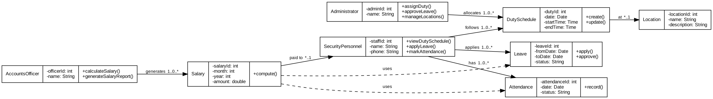
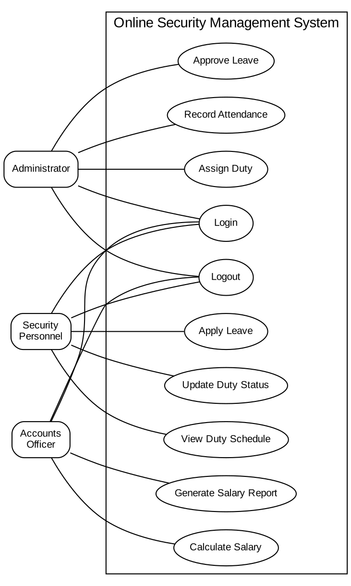
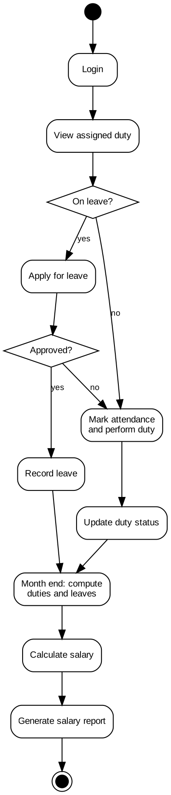

# Experiment 7: UML Diagrams for a College Security Management System

**Tool:** Umbrello &nbsp;|&nbsp; **Course Outcome:** CO1 &nbsp;|&nbsp; **Course:** CSA10 Software Engineering

## Aim

To design the Class diagram, Use Case diagram and Activity diagram for a Security Management System that manages the security personnel of a college.

## Procedure outline

1. Launch the UML Modeling Tool
2. Analyze the Problem Statement
3. Create the Class Diagram
4. Create the Use Case Diagram
5. Create the Activity Diagram
6. Verify the Class Diagram
7. Verify the Use Case Diagram
8. Verify the Activity Diagram
9. Save the UML Project
10. Export the Diagrams

## Expected output

Class diagram of the Security Management System with attributes, methods and associations.

Use Case diagram with all actors and use cases inside the system boundary.

Activity diagram showing the duty and incident-reporting workflow.

## GitHub deliverables (what to commit in this folder)

- [ ] Umbrello/StarUML project file (`.xmi` / `.mdj`) in `uml/`
- [ ] Exported PNG/PDF of the Class, Use Case and Activity diagrams in `uml/`
- [ ] `uml/*.puml` PlantUML sources (included)

## Screenshots to capture (save in `screenshots/`)

- [ ] `screenshots/07-01.png` – Figure 7.1 – Create the Class Diagram
- [ ] `screenshots/07-02.png` – Figure 7.2 – Create the Use Case Diagram
- [ ] `screenshots/07-03.png` – Figure 7.3 – Create the Activity Diagram

## Links

Fill these in `links.md` before submitting.

## Result

Thus the Class, Use Case and Activity diagrams for the College Security Management System were designed and verified using the UML modelling tool.

Viva voce questions

**1. What is multiplicity?**

Ans: The number of instances of one class that can be associated with one instance of another class, e.g. 1..*.

**2. What is a system boundary?**

Ans: A rectangle in a use case diagram that separates the system’s use cases from external actors.

**3. Which diagram shows the static structure of a system?**

Ans: The Class diagram.

**4. What is a swimlane?**

Ans: A partition in an activity diagram that groups activities by the actor responsible.

**5. What is generalization?**

Ans: An inheritance relationship where a child class/actor specialises a parent.

## Diagrams (rendered)

Sources: `uml/*.dot` (Graphviz) and `uml/diagrams.md` (Mermaid). Replace or add your own Umbrello export if your faculty requires it.
