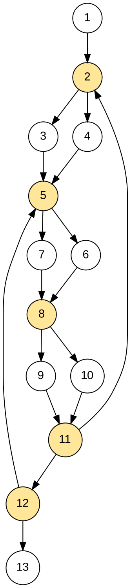

# Experiment 8: Cyclomatic Complexity of a Flow Graph

**Tool:** Raptor &nbsp;|&nbsp; **Course Outcome:** CO1 &nbsp;|&nbsp; **Course:** CSA10 Software Engineering

## Aim

To find the cyclomatic complexity of a program whose flow graph has 17 edges, 13 nodes and 5 predicate nodes, and to verify the result using the alternate formula.

## Procedure outline

1. Read the Problem Statement
2. Draw the Control Flow Graph
3. Count the Graph Components
4. Apply the Cyclomatic Complexity Formula
5. Calculate the Cyclomatic Complexity
6. Verify Using Predicate Nodes
7. Analyze the Result
8. Interpret the Complexity
9. Document the Result
10. Save the Work

## Expected output

Using V(G) = E − N + 2 = 17 − 13 + 2 = **6**

Using V(G) = P + 1 = 5 + 1 = **6**

Both methods give V(G) = 6, so at least six independent test paths are required.

## GitHub deliverables (what to commit in this folder)

- [ ] Hand-drawn or tool-drawn flow graph image (13 nodes, 17 edges, 5 predicate nodes)
- [ ] Calculation page showing V(G) = E − N + 2 = 6 and V(G) = P + 1 = 6
- [ ] `exp08-cyclomatic.py` (included)

## Screenshots to capture (save in `screenshots/`)

- [ ] `screenshots/08-01.png` – Figure 8.1 – Save the Work
- [ ] `screenshots/08-02.png` – Figure 8.2 – Save the Work

## Links

Fill these in `links.md` before submitting.

## Result

Thus the cyclomatic complexity of the given flow graph was calculated as V(G) = 6 using both formulae, indicating six independent paths and moderate complexity.

Viva voce questions

**1. Who introduced cyclomatic complexity?**

Ans: Thomas J. McCabe in 1976.

**2. What is a predicate node?**

Ans: A node containing a condition (decision), from which two or more edges leave.

**3. What is basis path testing?**

Ans: A white-box technique that designs test cases to execute every independent path at least once.

**4. What does V(G) = 6 tell the tester?**

Ans: At least six test cases are needed to cover all independent paths.

**5. Is cyclomatic complexity a black-box or white-box metric?**

Ans: White-box – it needs the internal structure of the code.

## Flow graph (rendered)

13 nodes, 17 edges, 5 predicate nodes (shaded: 2, 5, 8, 11, 12). V(G) = 17 − 13 + 2 = 6 and V(G) = 5 + 1 = 6. Run `python exp08-cyclomatic.py` to check.
